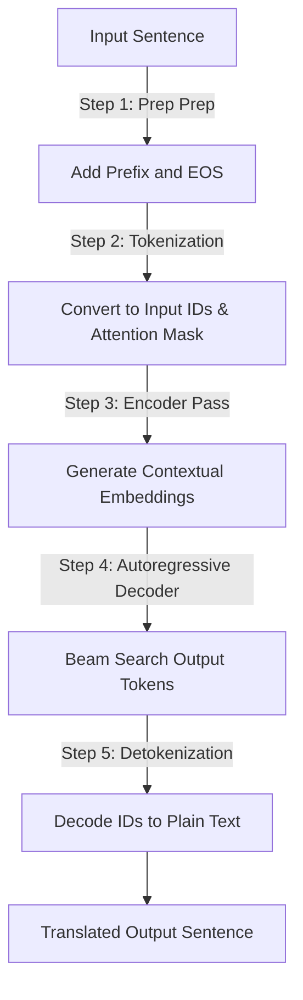

# Technical Report: Architectural Specification and Parameter Analysis of the Custom ByT5 Gondi Model

---

## Executive Summary
This report provides a detailed breakdown of the architectural design, parameter mathematics, optimization choices, and translation pipeline for the custom ByT5 model (`byt5_gondi_model`). 

By adapting the ByT5 architecture to use a tailored **Byte-Pair Encoding (BPE)** tokenizer with a reduced vocabulary and scaled-down layer dimensions, we created an efficient **25.52 Million parameter** model. This custom model is optimized for multi-language translation between **Gondi, Hindi, and English** on low-resource datasets, preventing overfitting and speeding up training times compared to standard ByT5.

---

## 1. Architectural Overview & Configuration

The model is built using the standard T5 (Text-to-Text Transfer Transformer) encoder-decoder structure configured with ByT5-style properties (such as gated-GELU feed-forward projections and a higher ratio of encoder-to-decoder layers).

The structural hyperparameters of the custom ByT5 Gondi model are:

| Hyperparameter | Description | Value |
| :--- | :--- | :--- |
| $V$ | Vocabulary Size (BPE Tokenizer) | $5,000$ |
| $d_{model}$ | Model / Hidden Representation Dimension | $384$ |
| $d_{ff}$ | Feed-Forward Layer Dimension | $1,024$ |
| $h$ | Attention Heads | $6$ |
| $d_{kv}$ | Key-Value Projection Dimension | $64$ |
| $N_{enc}$ | Encoder Blocks | $8$ |
| $N_{dec}$ | Decoder Blocks | $4$ |

---

## 2. Layer-by-Layer Mathematical Breakdown

The total parameter count ($P_{total}$) is calculated as the sum of the Shared Word Embeddings ($P_{embed}$), Encoder Parameters ($P_{enc}$), and Decoder Parameters ($P_{dec}$):
$$P_{total} = P_{embed} + P_{enc} + P_{dec}$$

### A. Shared Word Embeddings ($P_{embed}$)
The embedding layer maps discrete token IDs to dense vectors of dimension $d_{model}$. In the T5/ByT5 architecture, the input embeddings and output projection layer (Language Modeling Head) share (tie) their weights.
$$P_{embed} = V \times d_{model}$$
$$P_{embed} = 5,000 \times 384 = \mathbf{1,920,000\text{ parameters}}$$

---

### B. Encoder Architecture ($P_{enc}$)
The encoder consists of $N_{enc} = 8$ identical blocks. Each block has two main sub-layers: **Self-Attention** and a **Feed-Forward Network (FFN)**.

#### I. Sub-Layer 0: Multi-Head Self-Attention
* **Projection Matrices ($W_Q, W_K, W_V, W_O$)**:
  Queries, Keys, and Values project from $d_{model}$ (384) to the attention workspace ($h \times d_{kv} = 6 \times 64 = 384$):
  * $W_Q \text{ weight shape } [384, 384] = 147,456$
  * $W_K \text{ weight shape } [384, 384] = 147,456$
  * $W_V \text{ weight shape } [384, 384] = 147,456$
  * $W_O \text{ weight shape } [384, 384] = 147,456$
  $$\text{Projection subtotal} = 147,456 \times 4 = 589,824\text{ parameters}$$
* **RMS Normalization (Scale weight)**:
  * $\text{RMSNorm shape } [384] = 384\text{ parameters}$
* **Relative Position Bias Table** *(Instantiated in Encoder Block 0 only)*:
  * $\text{Bias matrix shape } [32\text{ buckets}, 6\text{ heads}] = 192\text{ parameters}$

#### II. Sub-Layer 1: Gated-GELU FFN
Unlike a standard ReLU FFN which uses two projection matrices, ByT5 uses a Gated-GELU structure requiring **three** projection matrices ($W_{i0}, W_{i1}, W_o$):
* **Feed-Forward Weights ($W_{i0}, W_{i1}, W_o$)**:
  * $W_{i0} \text{ weight shape } [1024, 384] = 393,216$ (Gate projection)
  * $W_{i1} \text{ weight shape } [1024, 384] = 393,216$ (Value projection)
  * $W_o \text{ weight shape } [384, 1024] = 393,216$ (Output projection)
  $$\text{FFN subtotal} = 393,216 \times 3 = 1,179,648\text{ parameters}$$
* **RMS Normalization (Scale weight)**:
  * $\text{RMSNorm shape } [384] = 384\text{ parameters}$

#### III. Encoder Global Layer Norm
* $\text{Encoder final RMSNorm shape } [384] = 384\text{ parameters}$

#### IV. Encoder Summation
$$P_{enc} = N_{enc} \times \left( \text{Self-Attn Projections} + \text{RMSNorm}_1 + \text{FFN Projections} + \text{RMSNorm}_2 \right) + \text{RelBias} + \text{FinalNorm}$$
$$P_{enc} = 8 \times \left( 589,824 + 384 + 1,179,648 + 384 \right) + 192 + 384$$
$$P_{enc} = 8 \times 1,770,240 + 576 = \mathbf{14,162,496\text{ parameters}}$$

---

### C. Decoder Architecture ($P_{dec}$)
The decoder consists of $N_{dec} = 4$ identical blocks. Each block contains three sub-layers: **Self-Attention**, **Encoder-Decoder Cross-Attention**, and a **Gated-GELU FFN**.

#### I. Sub-Layer 0: Multi-Head Self-Attention
* Same as Encoder Self-Attention = $589,824 \text{ (Projections)} + 384 \text{ (RMSNorm)} = 590,208\text{ parameters}$
* **Relative Position Bias Table** *(Instantiated in Decoder Block 0 only)*:
  * $\text{Bias matrix shape } [32\text{ buckets}, 6\text{ heads}] = 192\text{ parameters}$

#### II. Sub-Layer 1: Encoder-Decoder Cross-Attention (EncDecAttention)
* Queries project from decoder states; Keys/Values project from encoder outputs:
  * $W_Q, W_K, W_V, W_O \text{ shape equivalent to Self-Attention} = 589,824\text{ parameters}$
* **RMS Normalization (Scale weight)**:
  * $\text{RMSNorm shape } [384] = 384\text{ parameters}$

#### III. Sub-Layer 2: Gated-GELU FFN
* Same as Encoder FFN = $1,179,648 \text{ (Projections)} + 384 \text{ (RMSNorm)} = 1,180,032\text{ parameters}$

#### IV. Decoder Global Layer Norm
* $\text{Decoder final RMSNorm shape } [384] = 384\text{ parameters}$

#### V. Decoder Summation
$$P_{dec} = N_{dec} \times \left( \text{Self-Attn} + \text{Cross-Attn} + \text{FFN} + 3 \times \text{RMSNorm} \right) + \text{RelBias} + \text{FinalNorm}$$
$$P_{dec} = 4 \times \left( 589,824 + 589,824 + 1,179,648 + (3 \times 384) \right) + 192 + 384$$
$$P_{dec} = 4 \times \left( 2,359,296 + 1,152 \right) + 576$$
$$P_{dec} = 4 \times 2,360,448 + 576 = \mathbf{9,442,368\text{ parameters}}$$

---

### D. Grand Total Parameter Synthesis
$$P_{total} = P_{embed} + P_{enc} + P_{dec}$$
$$P_{total} = 1,920,000 + 14,162,496 + 9,442,368 = \mathbf{25,524,864\text{ parameters}}$$

This confirms the exact parameter count of **25,524,864 (~25.52 Million)**.

---

## 3. Parameter and Size Reduction Rationale

To make the ByT5 model suitable for local training and inference on a consumer GPU while working with a smaller, domain-specific 60,000-sentence corpus, we adjusted the parameters as follows:

| Metric | Google ByT5-Small | Custom ByT5 Gondi Model | Rationale for Reduction |
| :--- | :---: | :---: | :--- |
| **Total Parameters** | **300 Million** | **25.52 Million** | **Over 91% reduction in total parameters**, fitting easily into GPU/CPU memory and speeding up training cycles. |
| **Vocabulary Size ($V$)** | $384$ (raw bytes) | $5,000$ (BPE tokens) | Custom BPE vocabulary maps language-specific subwords. While it increases embedding size slightly, it dramatically shortens the sequence lengths. |
| **Model Dimension ($d_{model}$)** | $1,472$ | $384$ | Reduces representation vector width. This quadratically decreases weight matrices for all projection and attention layers by a factor of ~14.6. |
| **Feed-Forward Dimension ($d_{ff}$)** | $3,840$ | $1,024$ | Decreases FFN width. Combined with gated-GELU, it reduces FFN parameters per layer from ~16.9M to ~1.18M. |
| **Attention Heads ($h$)** | $6$ | $6$ | Matches the original head count but scales with smaller $d_{model}$ (dimension per head stays $d_{kv} = 64$). |
| **Encoder / Decoder Layers** | $12\text{ / } 4$ | $8\text{ / } 4$ | Reduces encoder depth from 12 to 8. This saves 33% of the encoder computation and reduces memory requirements during backpropagation. |
| **Tokenization Style** | Character/Byte-level | Subword-level BPE | ByT5 normally processes UTF-8 bytes, which makes sequences 4-5x longer. By using BPE subwords, sequence length drops by ~75%, saving quadratic attention memory. |

---

## 4. How the Translation Pipeline Works

The model translates text using the following step-by-step sequence:

### Step 1: Prompt/Prefix Preprocessing
To handle multiple translation directions within a single model, we prepend a target instruction prefix to the source string.
- *Example*: Translating "Gondi input" to Hindi becomes:
  `"translate Gondi to Hindi: Gondi input </s>"`

### Step 2: Tokenization via BPE
The tokenizer converts the preprocessed text into token IDs using Byte-Pair Encoding:
- **Input IDs**: Numerical tokens representing subword units.
- **Attention Mask**: Binary mask indicating active tokens vs. `[PAD]` padding tokens (so the attention layers ignore padding).
- *Implementation Reference*: [byt5_inference.py:L18-L21](file:///d:/New%20models%20Lokesh%20sir/Byt5%20Model/Scripts/byt5_inference.py#L18-L21)

### Step 3: Encoder Forward Pass
The encoder (8 blocks) processes the sequence of token IDs.
- Applies self-attention with relative position biases to capture relationships between words.
- Projects features through the gated-GELU feed-forward networks.
- Outputs a sequence of key-value states for the decoder.

### Step 4: Decoder Generation (Beam Search)
The decoder (4 blocks) generates the target sequence token-by-token (autoregressively):
- Uses **Beam Search** (with `num_beams=4`) to track the top-4 most likely translation paths, preventing greedy decoding errors.
- Connects to encoder outputs using cross-attention.
- Stops generating when the End-Of-Sequence (`</s>`) token is emitted or `max_length=128` is reached.
- *Implementation Reference*: [byt5_inference.py:L26-L32](file:///d:/New%20models%20Lokesh%20sir/Byt5%20Model/Scripts/byt5_inference.py#L26-L32)

### Step 5: Detokenization
The generated output token IDs are converted back into a human-readable text string. Special control tokens like `[PAD]`, `[START]`, and `</s>` are skipped.
- *Implementation Reference*: [byt5_inference.py:L34](file:///d:/New%20models%20Lokesh%20sir/Byt5%20Model/Scripts/byt5_inference.py#L34)
